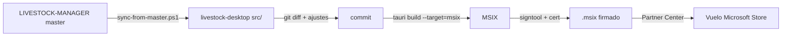
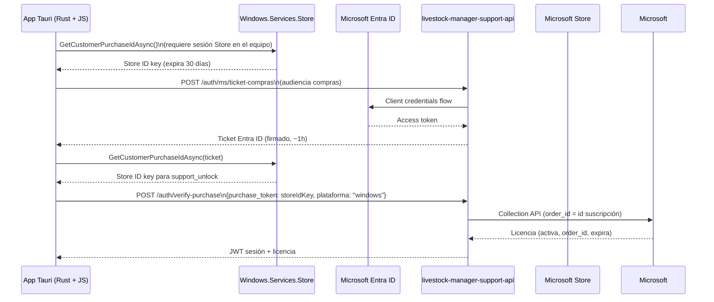

# Arquitectura Desktop — livestock-desktop

App Tauri (Rust + WebView2) para Windows nativa. Comparte la "piel ERP" con `LIVESTOCK-MANAGER` (sincronizada desde `master` via script), pero tiene su propio backend Rust, empaquetado MSIX y distribución por Microsoft Store (vuelo).

## Stack tecnológico

| Capa | Tecnología | Detalles |
|---|---|---|
| Frontend | Vanilla JS + CSS | Mismo código base que LIVESTOCK-MANAGER (copia de `index.html`, `css/`, `js/`) |
| Backend | Rust (Tauri v2) | `src-tauri/src/` — comandos, plugins, store ID key |
| Runtime | WebView2 (Evergreen) | `tauri.conf.json` → `windows.webviewVersion` |
| Empaquetado | MSIX (signtool) | `tauri build --target=msix` → Partner Center (vuelo) |
| Compra Soporte | Digital Goods (WinRT) | Store ID key → `POST /auth/verify-purchase` (Worker) |

## Estructura del proyecto

```
livestock-desktop/
├── src/                     # Frontend (copiado de LIVESTOCK-MANAGER)
│   ├── css/                 # design-tokens, erp-*, styles, layout
│   ├── js/                  # app.js, erp-shell.js, erp-data-table.js, views/
│   ├── index.html           # Sin capacitor.js (nativo Tauri)
│   └── manifest.webmanifest # PWA manifest (no usado en desktop nativo)
├── src-tauri/
│   ├── src/
│   │   ├── main.rs          # Entry point Tauri
│   │   ├── commands.rs      # Comandos invocables desde JS
│   │   ├── store.rs         # WinRT Store ID key (obtener_clave)
│   │   └── lib.rs           # Módulos públicos
│   ├── Cargo.toml           # Dependencias: tauri, windows, serde, etc.
│   ├── tauri.conf.json      # Config Tauri (identifier, windows, plugins)
│   └── build.rs             # Build script (iconos, etc.)
├── scripts/
│   └── sync-from-master.ps1 # Sincroniza frontend desde LIVESTOCK-MANAGER master
├── PLAN-DESKTOP.md          # Plan de trabajo desktop (histórico)
├── CHANGELOG.md             # Cambios por versión
└── README.md                # Documentación principal
```

## Flujo de sincronización con LIVESTOCK-MANAGER



Script `scripts/sync-from-master.ps1`:
- Copia `css/`, `js/`, `icons/`, `index.html`, `manifest.webmanifest` desde `..\LIVESTOCK-MANAGER`
- **Preservados** (no se sobrescriben): archivos listados en `$preservedList` (ej. `src-tauri/`, `scripts/`, `Cargo.toml`, `tauri.conf.json`, `CHANGELOG.md`, `PLAN-DESKTOP.md`)
- **Regla**: `preserve` línea activa = mantiene archivo local; comentada = sincroniza desde maestro.

**Post-merge (PR #179)**: quitados 3 ficheros del `$preservedList`; quedaron `produccion/` y `manuales/` pendientes de decisión.

## Flujo de compra Soporte (support_unlock)



**Claves**:
- `order_id` de Microsoft = id de la suscripción, **estable al renovar**, cambia al recontratar.
- El `purchase_token` que guarda el Worker **no es la Store ID key**, es el `order_id` (`mdr:0:...`).
- La cuenta de la Store con sesión en el equipo **define la compra**, no el correo de Ajustes.

## Comandos Tauri (Rust → JS)

| Comando | Descripción |
|---|---|
| `obtener_clave_store` | WinRT `GetCustomerPurchaseIdAsync` → Store ID key |
| `verificar_licencia` | Llama a Worker `/auth/verify-purchase` |
| `acunar_ticket_ms` | Llama a Worker `/auth/ms/ticket-compras` |
| `guardar_copia_seguridad` | Exporta DB a archivo (descarga) |
| `restaurar_copia_seguridad` | Importa DB desde archivo |
| `obtener_version` | Versión app desde `tauri.conf.json` |

## Build y publicación MSIX

### Local (requiere certificado)

```powershell
# 1. Certificado CNG (New-SelfSignedCertificate roto)
certreq -new request.inf cert.cer
# 2. Build MSIX
npm run tauri build -- --target msix
# 3. Firmar
signtool sign /fd SHA256 /a /f cert.pfx /p <pass> /tr http://timestamp.digicert.com /td SHA256 .\target\...\*.msix
```

**Nota**: `build:msix` necesita `--runner npm` (falla con `cargo tauri`). Devuelve exit 0 aunque falle — verificar salida.

### CI / Partner Center

- **Dos canales**: Producción = PWA (livestock-pwa-msix); Vuelo = Tauri (este repo). No confundir pantallas.
- Store ID `support_unlock` configurado en Partner Center (suscripción).
- Versionado: Android/PWA `v4.10.8` vs Windows/Tauri `v4.11.24.0` (versionCode 548+).

## Piel ERP en desktop

Activada por defecto en `>=1024px` (`matchMedia` en `erp-shell.js`). Archivos sincronizados desde maestro:
- `js/erp-shell.js`, `js/erp-data-table.js`
- `css/erp-tokens.css`, `css/erp-sidebar.css`, `css/erp-data-table.css`

**Desktop no tiene** `css/desktop.css` ni `css/erp-overrides.css` — esos son exclusivos de la PWA.

## Variables de entorno / Secretos

| Variable | Dónde | Qué |
|---|---|---|
| `MS_ENTRA_TENANT_ID` | Worker secret | Entra ID tenant |
| `MS_ENTRA_CLIENT_ID` | Worker secret | App registration client ID |
| `MS_ENTRA_CLIENT_SECRET` | Worker secret | Client secret |
| `JWT_SECRET` | Worker secret | Firma JWT sesión |
| `GOOGLE_PLAY_SERVICE_ACCOUNT_JSON` | Worker secret | Solo para Android testing local |
| `GITHUB_APP_*` | Worker secret | GitHub App para issues |
| `ENTORNO=development` | `.dev.vars` | Salta verificación licencia local |

## Reglas de desarrollo

- **Frontend**: editar en `LIVESTOCK-MANAGER` → `sync-from-master.ps1` → revisar `git diff` → commit.
- **Rust**: editar en `src-tauri/src/` → `cargo check` → `tauri dev` para probar.
- **Certificado local**: usar `certreq` con proveedor CNG + `MSYS_NO_PATHCONV=1` para `signtool`.
- **Testing licencia real**: solo en MSIX firmado instalado desde Store/Partner Center (`tauri dev` no tiene identidad de paquete).
- **CRLF/LF**: normalizar con `.gitattributes` — diff simétrico no es divergencia real.
- **Worktrees**: `git worktree list` antes de cualquier diff si hay varios worktrees.

## Referencias cruzadas

- `LIVESTOCK-MANAGER/docs/ARQUITECTURA_REPOS.md` — 3 repos, roles y flujo
- `livestock-manager-support-api/docs/KV_SCHEMA.md` — esquema KV del Worker
- `livestock-manager-support-api/README.md` — endpoints, identidad, flujo compra
- `memoria/conciliacion-desktop-maestro.md` — PR #179, preserves, estado actual